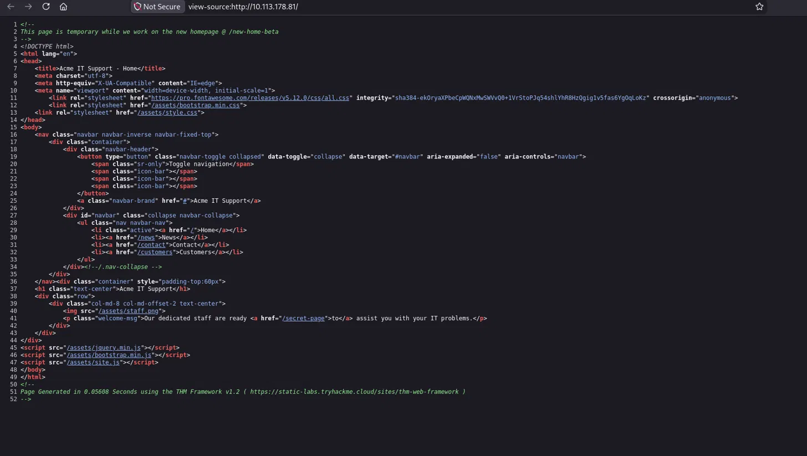
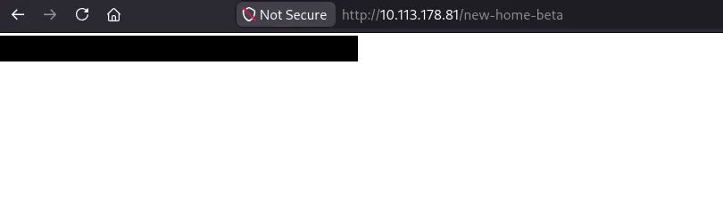
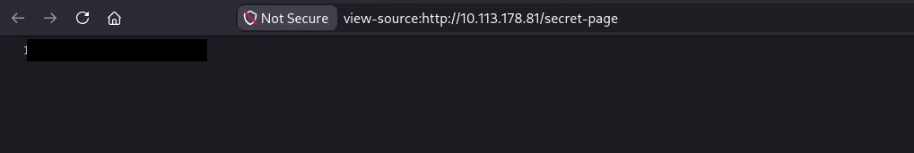
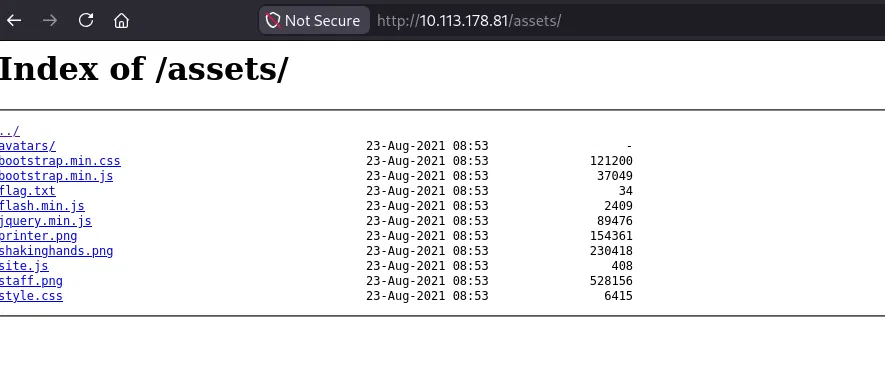
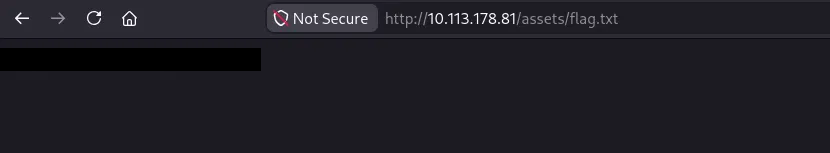
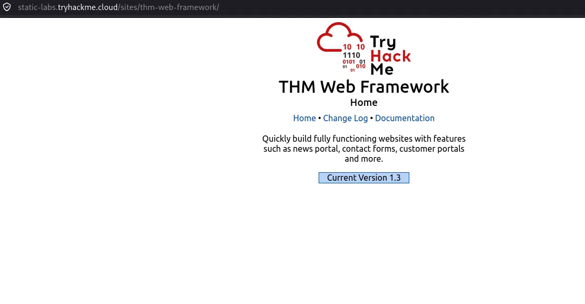
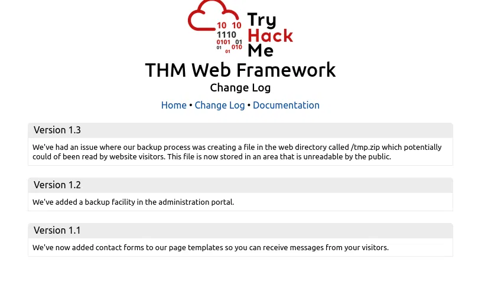

## Exercises

### Question 1 — What is the flag from the HTML comment?

I started by viewing the source of the Acme IT Support home page. The comment on lines 1 to 3 says the page is temporary while they work on the new homepage at `/new-home-beta`.



I went to the page the comment points at:

```
http://10.113.178.81/new-home-beta
```



**Answer:** `—REDACTED—`

### Question 2 — What is the flag from the secret link?

Further down the same source, on line 41, there is an anchor tag whose `href` points to `/secret-page`. It sits inside the welcome message, and the visible page gives no sign of it. I followed that link to get the flag.



**Answer:** `—REDACTED—`

### Question 3 — What is the directory listing flag?

The source loads the site's CSS, JavaScript and images from `/assets/`. I went to that directory in the browser and directory listing is enabled, so every file in it is listed. One of them is `flag.txt`.



I clicked `flag.txt`:



**Answer:** `—REDACTED—`

### Question 4 — What is the framework flag?

The comment at the bottom of the source (lines 50 to 52) says the page was generated using the THM Framework v1.2 and links to the framework's website. I went there:

```
https://static-labs.tryhackme.cloud/sites/thm-web-framework
```



The framework's home page lists the current version as 1.3, so the target is out of date. I opened the Change Log to see what changed between the two versions. Version 1.3 fixed a bug, so my plan was to go to wherever that bug points. The entry reads:

```
Version 1.3
We've had an issue where our backup process was creating a file in the web directory called /tmp.zip which potentially could of been read by website visitors. This file is now stored in an area that is unreadable by the public.
```


The target is on version 1.2, so it should still have the file in its web directory. I visited it, and the browser downloaded it:

```
http://10.113.178.81/tmp.zip
```

I then listed my Downloads folder, unzipped the archive and read the file inside:

```shell
┌──(—REDACTED—㉿kali)-[~/Downloads]
└─$ ls

tmp.zip

┌──(—REDACTED—㉿kali)-[~/Downloads]
└─$ unzip tmp.zip

Archive:  tmp.zip
 extracting: flag.txt

┌──(—REDACTED—㉿kali)-[~/Downloads]
└─$ cat flag.txt

—REDACTED—
```

**Answer:** `—REDACTED—`