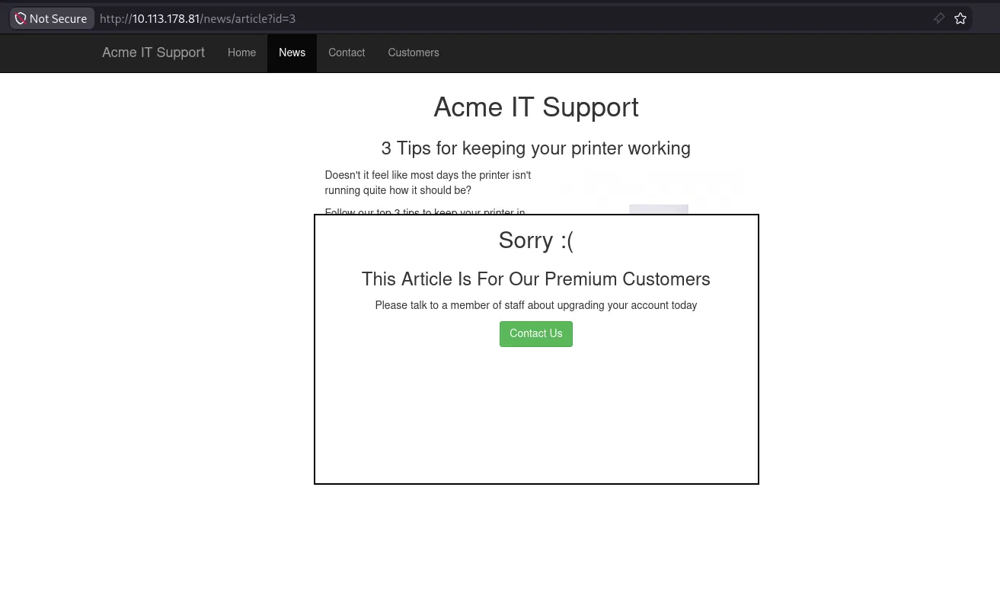
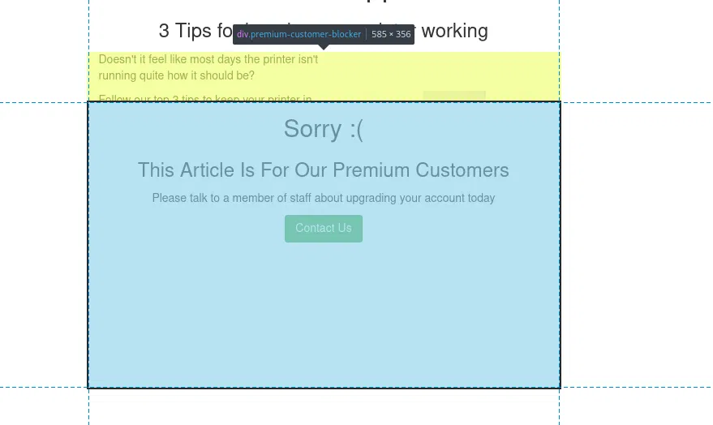
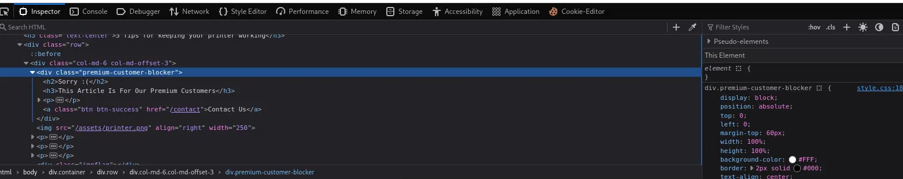
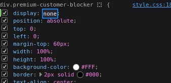
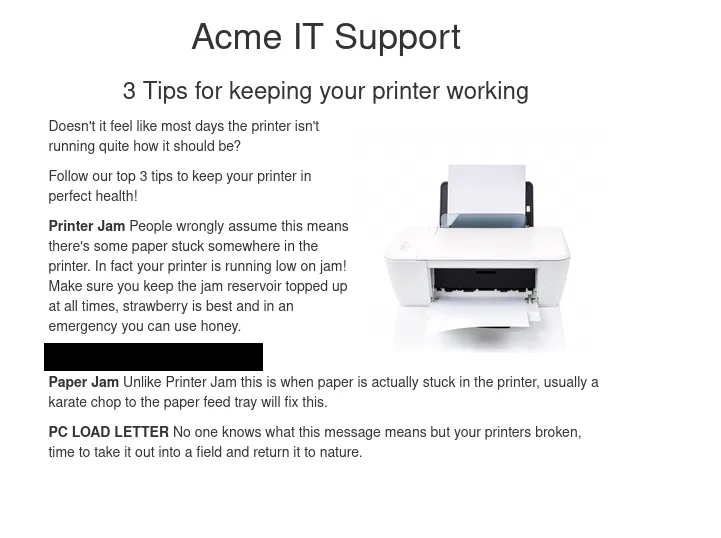

## Exercises

### Question 1 — What is the flag behind the paywall?

I went to the third news article, the one with the premium notice covering its content:

```
http://10.113.178.81/news/article?id=3
```



I pressed `Ctrl + Shift + C`, which opens the browser's developer tools with the Inspector in element-picking mode. I hovered over the premium notice and clicked it. The Inspector jumped straight to the `div` with the class `premium-customer-blocker`, and its CSS styles appeared in the styles box on the right.





In the styles box, the first style on that element was `display: block`. I clicked the word `block` and changed it to `none`.

```css
display: none;
```

**Breakdown:**

- `display` is the CSS property that controls whether and how an element is shown
- `none` tells the browser not to display the element at all, so the paywall box disappears

The line replaces the original `display: block` on the paywall element, and the change exists only in my browser window.



The box vanished and the article text appeared, with the flag sitting between the Printer Jam and Paper Jam tips.



**Answer:** `—REDACTED—`