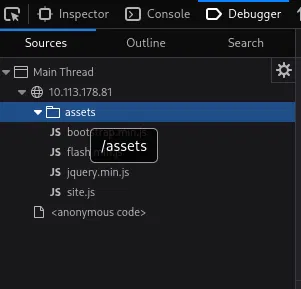
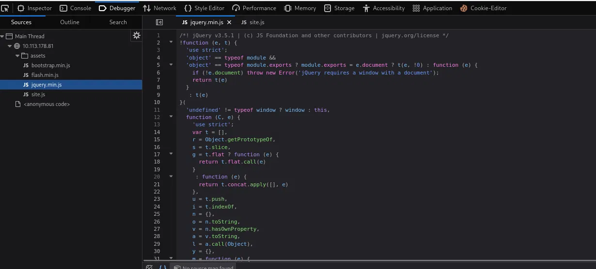
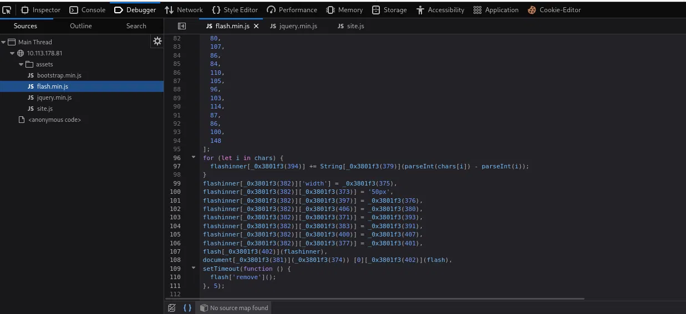
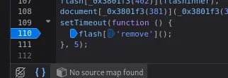
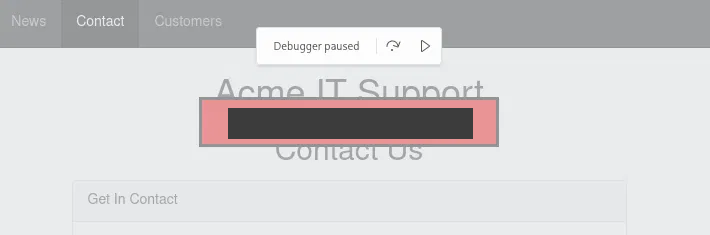

## Exercises

### Question 1 — What is the flag in the red box?

I went to the Contact page and reloaded it. A red box flashes on the screen for a second. I naturally could not get it on a screenshot, because it appears and disappears too fast.

I opened the developer tools, went to the Debugger, then the Sources list, and opened the `assets` folder. It holds `bootstrap.min.js`, `flash.min.js`, `jquery.min.js` and `site.js`.



I started with `jquery.min.js` and beautified it. It was still obviously obfuscated, so I moved on.



I then opened `flash.min.js` and beautified that one. Scrolling to the bottom, I found the line `flash['remove']();` on line 110, inside a `setTimeout` call:

```javascript
setTimeout(function () {
  flash['remove']();
}, 5);
```



**Breakdown:**

- `setTimeout(...)` runs a function after a delay
- `function () { ... }` is the function that will run
- `flash['remove']();` selects the `remove` function on the `flash` object and calls it, which removes the red box from the page
- `5` is the delay in milliseconds before the function runs, which is why the box disappears almost at once

Together, these lines wait 5 milliseconds after the red box is added and then remove it.

I clicked line 110 to add a breakpoint, so the browser pauses execution when it reaches that line. The line number turned blue.



Then I reloaded the page. The Debugger paused, the red box stayed on the page, and the flag was inside it.



**Answer:** `—REDACTED—`