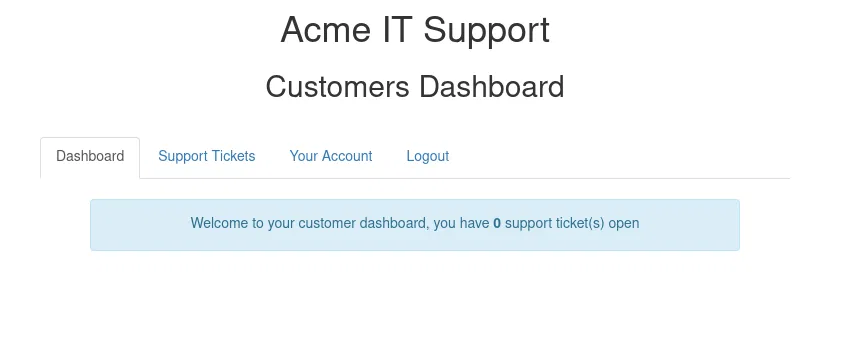

## Exercises

### Question 1 — What is the value of the HttpOnly flag after logging in?

I signed up on the Acme IT Support site, which logged me in and took me to the Customers Dashboard.

I then opened the Storage tab in the developer tools and went to Cookies. The site has set one cookie, named `session`. Its details list the cookie's attributes, including `HttpOnly`, which is the value the question asks for.

**Answer:** `false`